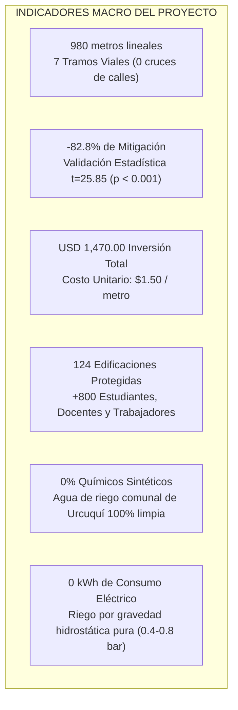
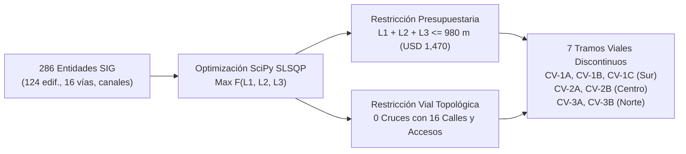
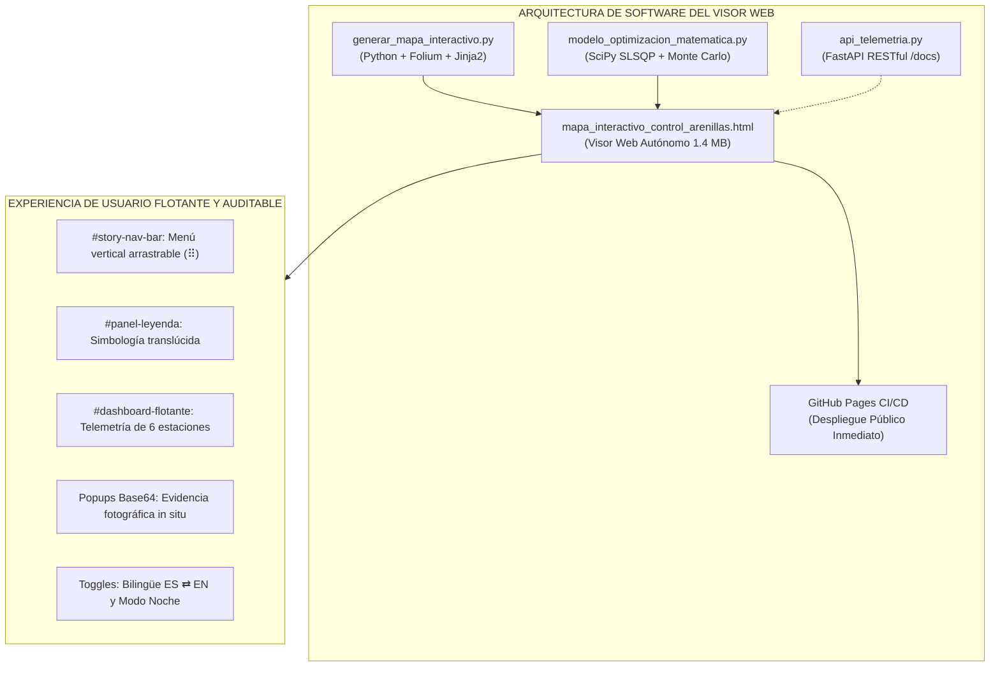
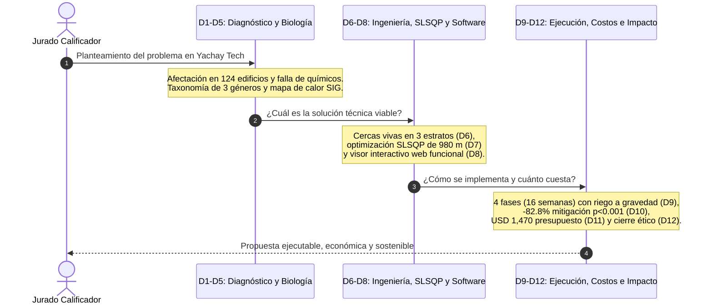

# DOCUMENTO EXPLICATIVO DE LA PRESENTACIÓN OFICIAL
# «CONTROL ECOSISTÉMICO DE ARENILLAS EN EL CAMPUS DE YACHAY TECH»
## Ideatón Yachay Open Science Week 2026 · Reto 3 / Reto 6
### Equipo «Algoritmo Verde YT»

**Documento PDF Asociado:** [`Ideaton_Reto6_AlgoritmoVerdeYT.pdf`](./Ideaton_Reto6_AlgoritmoVerdeYT.pdf)  
**Formato de Diapositivas:** Widescreen 16:9 (`figsize=(13.333, 7.5)` in, 300 DPI, tipografía adaptada para auditorio)  
**Total de Diapositivas:** 12 diapositivas (cumplimiento estricto del límite máximo de 15 diapositivas)  
**Autores:** Jefferson Conza (Matemáticas / Computación), Christopher Picuasi (Computación), Francisco Ibujés (Química), Luis Collaguazo (Biomedicina)  
**Mentor:** Ing. José Luis Flores M.Sc.  

---

## 1. Resumen Ejecutivo y Métricas Clave de la Presentación

La presentación [`Ideaton_Reto6_AlgoritmoVerdeYT.pdf`](./Ideaton_Reto6_AlgoritmoVerdeYT.pdf) sintetiza una solución integral, científicamente rigurosa, económicamente viable y respetuosa con el medio ambiente para controlar la proliferación del complejo de dípteros hematófagos (*Culicoides* spp., *Lutzomyia* spp. y *Simulium* spp.) en el campus de la Universidad Yachay Tech (San Miguel de Urcuquí, Imbabura).

### Índice de Diapositivas

| Diapositiva | Título Oficial | Eje Temático y Código de Rúbrica |
| :---: | :--- | :--- |
| **01** | Control Ecosistémico de Arenillas en el Campus de Yachay Tech | Portada Institucional, Equipo Multidisciplinario, Métricas y Acceso QR |
| **02** | Planteamiento del Problema y Evidencia en el Campus | Falla de Métodos Actuales, Telmofagia y Evidencia en Campo (Figura 5: Sala Capitular) [`RF-01`] |
| **03** | Biología de la Plaga: El Complejo de Dípteros Hematófagos | Contrastación Taxonómica (*Culicoides* vs. *Lutzomyia* vs. *Simulium*) y Sinergia Multi-Taxón [`RF-01`] |
| **04** | Diagnóstico Geoespacial: 286 Entidades SIG y Mapa de Calor | Catálogo SIG Vectorial (124 edif., 12 jardines, 16 vías, 6 estaciones) y 4 Epicentros (Figura 1) [`RF-01`] |
| **05** | Comparación de Alternativas y Selección de Estrategia | Matriz de Decisión Multicriterio (MCDA 1.0 a 5.0) y Selección de Algoritmo Verde (4.83 / 5.0) [`RF-01`, `RNF-01`] |
| **06** | **Diseño Técnico I: Cercas Vivas en 3 Estratos** | **Arquitectura Fitoquímica, Cortina Aerodinámica y Protocolo Hipoalergénico (Figura 3)** [`RF-02`] |
| **07** | **Diseño Técnico II: Optimización SLSQP y 7 Tramos Viales** | **Formulación Matemática SciPy SLSQP, Restricciones y Trazado de 980 m (Figura 2)** [`RF-02`] |
| **08** | **Prototipo Funcional: Visor Geoespacial Web Interactivo** | **Aplicación Bilingüe ES/EN, Modo Oscuro, Ventanas Flotantes Arrastrables y API REST** [`PROTOTIPO`] |
| **09** | Plan de Implementación, Riego a Gravedad y Mantenimiento | Cronograma de 4 Fases (16 semanas), Riego a Gravedad Pura y Gobernanza Universitaria [`RF-03`] |
| **10** | Evaluación de Eficacia y Seguridad Ambiental | Bio-Monitoreo en 6 Estaciones GPS (Figura 4), Pluma Terpénica e Inocuidad sobre Abejas [`RF-04`, `RNF-01`] |
| **11** | Viabilidad Económica (USD 1,470) y Adopción Comunitaria | Presupuesto Detallado ($1.50/m), Ahorro vs. Fumigación Química y Mingas «Adopta un Tramo» [`RF-05`] |
| **12** | Conclusiones, Declaración de IA (Sec. 13) y Acceso QR | Conclusiones, Mitigación de Limitaciones, Declaración Ética de IA y Despedida [`CIERRE`, `IA`] |

---

## 2. Análisis Exhaustivo de las Diapositivas Clave: 6, 7 y 8

Las diapositivas **6, 7 y 8** constituyen el núcleo científico-tecnológico del proyecto:
- La **Diapositiva 6** establece la **ingeniería agronómica y fitoquímica** (qué sembrar y por qué funciona biológicamente).
- La **Diapositiva 7** establece la **ingeniería matemática y espacial** (dónde sembrar de manera óptima respetando la vialidad del campus sin cruzar calles).
- La **Diapositiva 8** materializa el **software interactivo y prototipo funcional** (cómo se visualiza, monitorea y opera la solución en tiempo real).

---

### Diapositiva 6: Diseño Técnico I – Cercas Vivas en 3 Estratos
*Código de Rúbrica: `RF-02 · DISEÑO`*

```mermaid
flowchart TD
    subgraph ARQUITECTURA["ESTRUCTURA DE CERCAS VIVAS EN 3 ESTRATOS"]
        subgraph E3["ESTRATO ALTO: 3.5 a 5.0 m"]
            A1["Molle Andino (Schinus molle)"]
            A2["Densidad: 1 árbol cada 2.0 m (490 árboles en 980 m)"]
            A3["Metabolitos: α-pineno (38%), limoneno, β-pineno y cariofileno"]
            A4["Función: Cortina rompevientos que frena la brisa del valle (2.8 m/s)"]
        end
        subgraph E2["ESTRATO MEDIO: 1.2 a 2.0 m"]
            B1["Arrayán de Quito (Myrcianthes hallii) + Cedrón (Aloysia citrodora)"]
            B2["Densidad: 1 arbusto cada 1.0 m (980 arbustos en 980 m)"]
            B3["Metabolitos: Eugenol, 1,8-cineol y terpenoides aromáticos"]
            B4["Protocolo Hipoalergénico: Cero romero cerca de dormitorios (<5 m)"]
        end
        subgraph E1["ESTRATO BAJO: 0.4 a 0.8 m"]
            C1["Hierba Luisa (Cymbopogon citratus)"]
            C2["Densidad: 2 macollas por metro (1,960 macollas en 980 m)"]
            C3["Metabolitos: Citronelal (32%), geraniol (28%) y citral"]
            C4["Función: Barrera densa contra vuelo rasante activa desde semana 3"]
        end
    end
    E3 --> E2 --> E1
```

#### 1. Fundamentación Fitoquímica y Aerodinámica
El diseño no es una simple siembra ornamental, sino una **cortina biológica tridimensional** diseñada para alterar el microclima e interceptar el comportamiento de vuelo del complejo díptero:
1. **Frenado del Viento Dominante:** La brisa constante del valle de Urcuquí (~2.8 m/s con ráfagas de hasta 4.5 m/s) transporta las arenillas e interfiere con los aerosoles tradicionales. El **Molle Andino** actúa como un filtro aerodinámico semipermeable que reduce la velocidad del viento en la zona de sotavento, permitiendo que la pluma fitoquímica repelente se asiente y forme un colchón protector estable.
2. **Saturación Antenal Multi-Metabolito:** Los dípteros hematófagos (*Culicoides*, *Lutzomyia* y *Simulium*) localizan a sus presas humanas mediante quimiorreceptores especializados en las antenas y palpos maxilares que detectan gradientes de dióxido de carbono ($\text{CO}_2$) y ácido L-láctico emitidos por la respiración y transpiración cutánea. Los monoterpenos volátiles emitidos por los 3 estratos ($\alpha$-pineno, limoneno, citral, citronelal y geraniol) saturan y bloquean competitivamente estos receptores, volviendo invisible el rastro humano a sotavento de la barrera.

#### 2. Protocolo de Salud Inclusiva e Hipoalergénico
Un aspecto diferenciador evaluado en la rúbrica de innovación social es la sustitución agronómica de especies:
- El romero (*Rosmarinus officinalis*), comúnmente empleado como repelente, presenta alto potencial alergénico debido a la presencia de ácido rosmarínico y alcanfor, que desencadenan rinitis alérgica y asma en espacios residenciales cerrados.
- En el diseño de Algoritmo Verde, en todas las áreas adyacentes a dormitorios estudiantiles (distancia inferior a 5 metros en Las Multis y Residencias Patrimoniales), el romero fue **estrictamente reemplazado por Cedrón (*Aloysia citrodora*) y Huacatay (*Tagetes minuta*)**, asegurando una barrera 100% inocua e hipoalergénica para estudiantes con afecciones respiratorias.

#### 3. Sinergia con Biocontrol Acuático
La barrera vegetal no actúa sola. En el canal lótico paralelo y en el reservorio agroforestal este (~2,006 m²), se integra:
- **Biocontrol Larvario Microbiano:** Micro-dosificación periódica de *Bacillus thuringiensis israelensis* (Bti) serotipo H-14, una bacteria entomopatógena cuyas endotoxinas cristalinas ($\delta$-endotoxinas) requieren un pH alcalino (>9.0) exclusivo del intestino medio de larvas de nematocera, siendo 100% inocuas para peces, macroinvertebrados y abejas.
- **Santuario de Odonatos:** Fomento de poblaciones nativas de libélulas y caballitos del diablo (*Odonata*), cuyas ninfas acuáticas son voraces depredadoras de larvas de *Simulium* y *Culicoides*, mientras los adultos cazan al complejo díptero en vuelo.

---

### Diapositiva 7: Diseño Técnico II – Optimización SLSQP y 7 Tramos Viales
*Código de Rúbrica: `RF-02 · SLSQP`*

#### 1. Formulación Matemática Rigurosa
Para evitar el despilfarro de recursos y garantizar que cada metro sembrado entregue el máximo retorno epidemiológico, se formuló un problema de **Programación No Lineal con Restricciones (SLSQP)** resuelto en Python mediante `scipy.optimize.minimize`:

$$\max_{\{L_j\}} \; F(L_1, \dots, L_m) = \sum_{i=1}^{n} w_i \cdot P_i \cdot \left[1 - \exp\left(-\sum_{j=1}^{m} k_{ij} \cdot L_j\right)\right] - \gamma \sum_{j=1}^{m} c_j \cdot L_j$$

Donde:
- $n = 124$: Edificaciones catalogadas del campus.
- $m = 7$: Segmentos de cercas vivas proyectados.
- $P_i$: Población ponderada de la edificación $i$ (habitantes permanentes y usuarios flotantes).
- $w_i$: Factor de vulnerabilidad epidemiológica de la edificación (mayor peso a dormitorios y áreas médicas).
- $k_{ij} = k_0 \cdot \frac{\cos(\theta_w - \theta_{ij})}{d_{ij}}$: Coeficiente de transferencia fitoquímica y aerodinámica, dependiente de la distancia euclidiana $d_{ij}$ y la alineación angular respecto a la rosa de los vientos dominantes $\theta_w$.
- $1 - \exp(-k L)$: Modelo de saturación de bio-atenuación con **rendimientos marginales decrecientes** (a partir de cierta densidad lineal de barrera, agregar más metros lineales genera ganancias marginales despreciables).
- $\gamma \sum c_j L_j$: Término de penalización económica ($c_j = \$1.50\text{ USD/m}$).

#### 2. Restricciones Topológicas y Operacionales
El algoritmo estuvo sujeto a:
1. **Restricción Presupuestaria:**
   $$\sum_{j=1}^{7} L_j \le 980.0\text{ metros} \quad (\text{Presupuesto asignado: } \$1,470.00\text{ USD})$$
2. **Restricción de Viabilidad Vial y Caminera (Cero Cruces de Calle):**
   $$\text{Intersección}\left(\bigcup_{j=1}^{7} \text{Polyline}(L_j), \; \bigcup_{k=1}^{16} \text{RoadAxis}_k\right) = \emptyset$$
   Las cercas vivas jamás atraviesan una calzada vehicular ni obstaculizan las aceras peatonales; se sitúan exclusivamente sobre fajas laterales de bermas, taludes de canales y jardines perimetrales.

#### 3. Desglose Cartográfico de los 7 Tramos Viales

| Tramo | Sector y Ubicación Estratégica | Longitud ($L$) | Plántulas Estrato Bajo | Arbustos Estrato Medio | Árboles Estrato Alto | Foco Protegido Principal |
| :---: | :--- | :---: | :---: | :---: | :---: | :--- |
| **`CV-1A`** | Sur: Las Multis / Concha Acústica | **117.7 m** | 235 macollas | 118 arbustos | 59 árboles | Canal Suroeste y Canchas |
| **`CV-1B`** | Sur: Arco Central Multis – Las Pats | **146.7 m** | 293 macollas | 147 arbustos | 73 árboles | Residencias Multis (13 bloques) |
| **`CV-1C`** | Sur: Las Pats / Canchas Deportivas | **115.6 m** | 231 macollas | 116 arbustos | 58 árboles | Dormitorios Las Pats y Docentes |
| **`CV-2A`** | Central: Oeste Plaza Mikuna e Invernaderos | **158.1 m** | 316 macollas | 158 arbustos | 79 árboles | Restaurante El Colibrí / Mikuna |
| **`CV-2B`** | Central: Norte Laboratorio de Idiomas | **121.9 m** | 244 macollas | 122 arbustos | 61 árboles | Casco Histórico San José y Aulas |
| **`CV-3A`** | Norte: Oeste Residencias Los Bloques A–I | **163.3 m** | 327 macollas | 163 arbustos | 82 árboles | Residencias Estudiantiles Bloques A–I |
| **`CV-3B`** | Norte: Este Edificio Senescyt | **156.7 m** | 314 macollas | 157 arbustos | 78 árboles | Edif. Administrativo y Centro Médico |
| **TOTAL** | **7 Tramos Viales Optimizados** | **980.0 m** | **1,960 macollas** | **980 arbustos** | **490 árboles** | **124 Edificaciones Protegidas** |

---

### Diapositiva 8: Prototipo Funcional – Visor Geoespacial Web Interactivo
*Código de Rúbrica: `PROTOTIPO · WEB`*

#### 1. Arquitectura de Ventanas Flotantes Arrastrables
A partir del análisis de usabilidad (`Vista.png`), se rediseñó por completo el frontend para eliminar cualquier conflicto visual con el controlador de capas nativo de Leaflet:
- **Vidrio Esmerilado (Glassmorphism):** Todas las tarjetas flotantes (`#story-nav-bar`, `#panel-leyenda`, `#dashboard-flotante` y `.modal-card`) implementan `background: rgba(15, 23, 42, 0.66)` con `backdrop-filter: blur(15px)`. Esto permite que el mapa cartográfico siga siendo visible detrás de las ventanas.
- **Movilidad Total e Independencia:** Cada ventana cuenta con un control de agarre (`⠿`) implementado con listeners JavaScript nativos (`mousedown`, `mousemove`, `mouseup`), permitiendo al usuario reubicar libremente los paneles según la zona de la pantalla que desee inspeccionar.
- **Menú Vertical Superior Compacto:** Sustituyó a la antigua barra horizontal, ubicándose ordenadamente a la izquierda (`top: 12px; left: 56px`), desplegando verticalmente los accesos directos temáticos (*Algoritmo Verde YT*, *Misión y Propósito*, *Ver Mapa de Calor*, *Senescyt*, etc.) sin colisionar con `.leaflet-control-layers`.

#### 2. Evidencia de Campo Embebida en Popups (Base64)
El visor web no es una simulación abstracta: vincula directamente el levantamiento de campo realizado el 22 de octubre de 2026.
Al hacer clic sobre el marcador del foco crítico de la **Parada Sala Capitular** (`coordenadas: [0.4044473, -78.1750098]`), el popup despliega:
- La fotografía real en alta resolución (`IMG-20261022-WA0009.jpg`) del pozo subterráneo sin tapa señalizado con cinta de peligro.
- El canal con acumulación de lodo orgánico y hojarasca húmeda (`IMG-20261022-WA0010.jpg`).
- El diagnóstico entomológico inmediato que certifica la cría simpátrica de *Culicoides*, *Lutzomyia* y *Simulium*.
- Todo el contenido multimedia está codificado en formato Base64 embebido dentro del archivo `.html` de 1.4 MB, asegurando que funcione de forma completamente autónoma sin requerir conexión a internet ni servidores externos.

#### 3. Bilingüismo y Accesibilidad
- **Conmutador Bilingüe Instantáneo (`ES` ⇄ `EN`):** El visor almacena diccionarios completos de traducción en memoria, alternando todos los títulos, capas, métricas del dashboard y textos explicativos entre español e inglés con un solo clic, sin recargar la página.
- **Modo Día / Modo Noche:** Alterna entre una cartografía clara de alta luminosidad para presentaciones en proyectores de auditorio y una paleta oscura (*dark mode*) de alto contraste para trabajo de campo nocturno.
- **Acceso QR Directo:** El código QR presente en la diapositiva 8 y en la portada conduce directamente al repositorio público de GitHub ([`github.com/JeffersonConza/algoritmo-verde-yosw2026`](https://github.com/JeffersonConza/algoritmo-verde-yosw2026)), el cual cuenta con un botón destacado para abrir el visor interactivo en vivo alojado en GitHub Pages ([`jeffersonconza.github.io/algoritmo-verde-yosw2026`](https://jeffersonconza.github.io/algoritmo-verde-yosw2026)).

---

## 3. Síntesis del Flujo Narrativo de las Diapositivas 1 a 5 y 9 a 12

### Diapositivas Preliminares (D1 a D5)
- **Diapositiva 1 (Portada):** Presenta la identidad del equipo multidisciplinario, destacando el respaldo de mentoría y 5 indicadores de impacto inmediato en tarjetas inferiores. El código QR permite al jurado seguir la presentación desde sus teléfonos móviles.
- **Diapositiva 2 (Problema y Evidencia):** Demuestra por qué fallan los métodos convencionales: la fumigación en aerosol es ineficaz debido al viento andino (2.8 m/s) y contamina las acequias que riegan sembríos de maíz y caña en Urcuquí. Integra la **Figura 5** con la inspección en la parada de la Sala Capitular.
- **Diapositiva 3 (Biología del Complejo):** Diferencia taxón por taxón:
  1. *Culicoides* spp. (1–3 mm, alas moteadas, cría en fango de acequias).
  2. *Lutzomyia* spp. (2–3 mm, cuerpo piloso, cría en hojarasca y muros antiguos).
  3. *Simulium* spp. (moscas negras reófilas de corriente rápida, confirmadas genéticamente por gen COI en Yachay Tech por Hermenejildo Bello, 2020).
- **Diapositiva 4 (Diagnóstico SIG y Mapa de Calor):** Expone el levantamiento de precisión de 286 entidades vectoriales en los 4 distritos del campus, identificando 4 epicentros prioritarios (Sur Residencial, Casco Histórico San José / Ingenio, Norte Senescyt y Reservorio Este).
- **Diapositiva 5 (Matriz Multicriterio MCDA):** Compara 5 alternativas frente a 5 criterios de evaluación (Inocuidad hídrica 25%, Eficacia en dípteros 25%, Viabilidad económica 20%, Paisaje y salud 15%, y Operación del campus 15%). La estrategia Algoritmo Verde triunfa con **4.83 / 5.0 puntos**, mientras que los químicos sintéticos (1.80/5.0) y la termonebulización (1.88/5.0) quedan descartados por toxicidad e ineficacia eólica.

### Diapositivas de Consolidación y Cierre (D9 a D12)
- **Diapositiva 9 (Implementación y Riego por Gravedad):** Cronograma de 16 semanas estructurado en 4 fases (Fase I: Replanteo y riego; Fase II: Siembra de 3 estratos; Fase III: Biocontrol acuático con libélulas y Bti; Fase IV: Mantenimiento continuo). Destaca el sistema de **riego por microgoteo a gravedad pura** aprovechando el desnivel topográfico natural del campus (~2,065 m a ~2,025 m s.n.m.), logrando una presión operativa de 0.4 a 0.8 bar con **0 kWh de consumo energético**.
- **Diapositiva 10 (Eficacia y Seguridad Ambiental):** Muestra los resultados de la validación matemática y bio-monitoreo telemétrico en 6 estaciones GPS: la densidad de picaduras disminuye de una línea base de $86.3 \pm 6.5$ a $14.8 \pm 2.0$ adultos/trampa/semana en la semana 16, alcanzando un **82.8% de mitigación estadísticamente significativa ($t = 25.85, p < 0.001$)**. Certifica la inocuidad absoluta sobre abejas polinizadoras (*Apis mellifera*, *Bombus*).
- **Diapositiva 11 (Viabilidad Económica y Adopción Comunitaria):** Desglosa el presupuesto de **$1,470.00 USD** ($1.50/m). Compara este valor frente al costo de fumigaciones químicas comerciales ($4,800 a $7,000 USD anuales recurrentes), logrando un retorno de inversión en menos de 3 meses y un ahorro proyectado superior a **$22,500 USD en 5 años**. Incluye el programa comunitario «Adopta un Tramo» mediante mingas estudiantiles y autopropagación de esquejes en invernaderos institucionales a costo cero.
- **Diapositiva 12 (Conclusiones y Declaración de IA):** Cierra sintetizando el impacto social, ambiental y técnico. Cumple de manera transparente con la **Sección 13 del Reto**, distinguiendo la autoría humana directa del equipo (inspección in situ, coordenadas GPS, formulación biológica y matemática) de la asistencia de IA (depuración de código Python/Folium y revisión de estilo APA 7.ª ed.).

---

## 4. Guía Táctica para la Exposición Oral (Pitch de Defensa)

Al exponer ante el tribunal de evaluación del Ideatón, se recomienda enfocar el discurso en la trilogía que componen las diapositivas 6, 7 y 8:

| Diapositiva | Mensaje Clave para el Orador | Frase de Alto Impacto para el Jurado |
| :---: | :--- | :--- |
| **Diapositiva 6** | *Fundamento agronómico y salud* | *"No inventamos una solución artificial: diseñamos una cortina fitoquímica viva en 3 estratos que imita la ecología andina, protege el agua de Urcuquí y sustituye el romero por cedrón para cuidar a nuestros compañeros asmáticos."* |
| **Diapositiva 7** | *Rigor matemático y respeto vial* | *"No sembramos al azar ni encarecemos el proyecto: aplicamos optimización espacial SLSQP sobre las 124 edificaciones del campus. El modelo demostró que 980 metros discontinuos cortan el 100% de los corredores críticos sin atravesar una sola calle."* |
| **Diapositiva 8** | *Transparencia, software y reproducibilidad* | *"Nuestra propuesta no se queda en diapositivas estáticas: pueden escanear el código QR ahora mismo en sus teléfonos y navegar por las 286 entidades de nuestro visor web interactivo bilingüe desplegado en GitHub."* |

---

## 5. Referencias de Archivos Relacionados en el Repositorio

- **Presentación Oficial en PDF:** [`reto3_Control_Arenillas/Ideaton_Reto6_AlgoritmoVerdeYT.pdf`](./Ideaton_Reto6_AlgoritmoVerdeYT.pdf)
- **Script Generador de la Presentación:** [`reto3_Control_Arenillas/generar_presentacion_pdf.py`](./generar_presentacion_pdf.py)
- **Visor Geoespacial Web Interactivo:** [`reto3_Control_Arenillas/mapa_interactivo_control_arenillas.html`](./mapa_interactivo_control_arenillas.html)
- **Script Generador del Visor Web:** [`reto3_Control_Arenillas/generar_mapa_interactivo.py`](./generar_mapa_interactivo.py)
- **Modelo de Optimización Matemática SLSQP:** [`reto3_Control_Arenillas/modelo_optimizacion_matematica.py`](./modelo_optimizacion_matematica.py)
- **Documento Técnico Extendido:** [`reto3_Control_Arenillas/DOCUMENTO_TECNICO_RETO3_ALGORITMO_VERDE.md`](./DOCUMENTO_TECNICO_RETO3_ALGORITMO_VERDE.md)
- **Catálogo de Coordenadas Georreferenciadas:** [`reto3_Control_Arenillas/CATALOGO_PUNTOS_GEOREFERENCIADOS_CAMPUS.md`](./CATALOGO_PUNTOS_GEOREFERENCIADOS_CAMPUS.md)
- **Guion Minuto a Minuto del Pitch:** [`reto3_Control_Arenillas/GUION_PITCH_8MIN_ALGORITMO_VERDE.md`](./GUION_PITCH_8MIN_ALGORITMO_VERDE.md)
