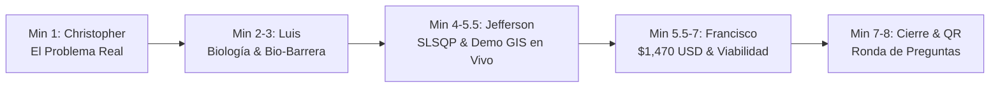

# GUION OFICIAL Y ESTRATEGIA DE PRESENTACIÓN (PITCH DE 8 MINUTOS)
## Yachay Open Science Week 2026 · Reto 3: Control de Arenillas
### Equipo: Algoritmo Verde YT
**Horario Asignado:** Viernes 23 de octubre de 2026 — **17:03**  
**Duración Estricta:** 8 minutos de exposición + ronda de preguntas del jurado.  
**Criterio Clave del Jurado:** *Propuesta coherente, realista, científicamente fundamentada y escalable.*

---

## 1. Distribución de Roles en el Pitch

| Integrante | Perfil | Rol en la Presentación | Tiempo |
| :--- | :--- | :--- | :---: |
| **Christopher Picuasi** | Computación (3.º sem.) | **Apertura:** El problema en el campus, afectación real y objetivos. | 1:00 min |
| **Luis Collaguazo** | Biomedicina (3.º sem.) | **Fundamentación Biológica:** Complejo vectorial (*Simulium* / *Culicoides*) y bio-repelencia tri-estrato. | 2:00 min |
| **Jefferson Conza** | Matemáticas (9.º sem.) | **Ingeniería Espacial & GIS:** Optimización SLSQP (980 m), demo en vivo del mapa interactivo (286 entidades). | 2:30 min |
| **Francisco Almeda** | Química (2.º sem.) | **Viabilidad Económica & Riego:** Presupuesto de $1,470 USD, autosuficiencia y comparativa de costos. | 1:30 min |
| **Todo el Equipo** | Multidisciplinario | **Cierre y Defensa:** Conclusión contundente y respuesta a preguntas del jurado. | 1:00 min |

---

## 2. Estructura Diapositiva por Diapositiva (Minuto a Minuto)

### Minuto 0:00 – 1:00 · Diapositiva 1: Portada y El Dolor Universitario
* **Orador:** Christopher Picuasi.
* **Apoyo Visual:** Diapositiva con título del proyecto, logos de YOSW y la foto real de campo tomada en la parada de la Sala Capitular (`IMG-20261022-WA0009.jpg`).
* **Guion sugerido:**
  > *"Buenas tardes, miembros del jurado calificador y comunidad de Yachay Tech. Somos **Algoritmo Verde YT**. Todos los que vivimos y estudiamos aquí conocemos esta escena: esperar el bus en la Sala Capitular, caminar hacia Los Bloques o intentar estudiar en las áreas verdes del campus y ser acorralados por nubes de picaduras. No es una molestia menor: afecta a 124 edificaciones y a más de 800 personas diariamente, provocando dermatitis, interrupción académica y pérdida de habitabilidad. Hoy les presentamos una solución que no depende de químicos tóxicos ni promesas costosas, sino de ciencia andina, bio-repelencia y optimización matemática."*

---

### Minuto 1:00 – 3:00 · Diapositivas 2 y 3: El Complejo Vectorial y la Solución Tri-Estrato
* **Orador:** Luis Collaguazo.
* **Apoyo Visual:** Diapositiva 2 con el diagrama del *Complejo Vectorial Díptero* (canales lóticos vs. márgenes fangosos) y Diapositiva 3 con el corte transversal de la barrera vegetal en 3 estratos (`Figura3_Corte_Transversal_Cercas_3Estratos.png`).
* **Guion sugerido:**
  > *"Para resolver un problema biológico, primero hay que entender al organismo. Lo que en Urcuquí llamamos 'arenillas' no es una sola especie, sino un **complejo vectorial díptero**: por un lado, **Simulium spp.** (moscas negras reófilas confirmadas por secuenciación genética COI en Yachay Tech), cuyas larvas necesitan el agua corriente continua de las acequias; y por otro, **Culicoides spp.** y **Lutzomyia spp.**, que proliferan en los márgenes fangosos y hojarasca sombreada.*  
  > *Fumigar con insecticidas sintéticos es un error grave: las acequias de Yachay irrigan los cultivos de maíz y caña del cantón Urcuquí; verter veneno envenenaría el agua comunal y crearía resistencia larvaria.*  
  > *Nuestra alternativa es una **Barrera Viva Tri-Estrato Hipoalergénica**:  
  > 1. **Estrato Arbóreo (Molle andino - Schinus molle):** Emite alfa-felandreno y cariofileno que bloquean los receptores térmicos del insecto.  
  > 2. **Estrato Arbustivo (Arrayán de Quito - Myrcianthes hallii):** Aporta follaje denso rico en eugenol que interrumpe físicamente el vuelo rasante.  
  > 3. **Estrato Herbáceo Basal (Hierba Luisa - Cymbopogon citratus y Cedrón):** Emisión constante de citral. Sustituimos plantas alergénicas como el romero por cedrón y huacatay cerca de dormitorios para proteger a residentes con asma o rinitis. La barrera actúa como un escudo fitoquímico pasivo 24/7."*

---

### Minuto 3:00 – 5:30 · Diapositivas 4 y 5: Optimización SLSQP y Demostración en Vivo del Mapa GIS
* **Orador:** Jefferson Conza.
* **Apoyo Visual:** Diapositiva 4 con la formulación matemática SLSQP y, de inmediato, cambiar a pantalla compartida / navegador con el visor interactivo [`mapa_interactivo_control_arenillas.html`](file:///mnt/c/Users/jconza/Documents/YOSW/reto3_Control_Arenillas/mapa_interactivo_control_arenillas.html).
* **Guion sugerido:**
  > *"¿Cómo sabemos exactamente dónde y cuánto sembrar sin despilfarrar recursos? Como matemático, formulé un modelo de **Optimización Espacial Multiobjetivo (algoritmo SLSQP)** que pondera la densidad humana, la dirección del viento andino y la cercanía a los focos de agua de los canales.*  
  > *El modelo demostró que no necesitamos cercar todo el cantón: el cerramiento óptimo requiere exactamente **12 segmentos estratégicos que suman 980 metros lineales**.*  
  > *(Cambio al visor GIS):*  
  > *Aquí observan nuestra plataforma geoespacial interactiva desarrollada en Python y Folium. Mapeamos y validamos **286 entidades GIS** cubriendo las **124 edificaciones del campus**, **12 áreas verdes y jardines patrimoniales** y **16 ejes viales y caminerías**: desde el complejo residencial sur (Las Multis, Las T's y Las Pats) hasta el Casco Histórico de San José y el Edificio Senescyt al norte.*  
  > *Diseñamos el visor de forma que los polígonos históricos del Ingenio y Sala Capitular no interfieran con la selección individual de cada edificio, permitiendo a la Dirección de Mantenimiento consultar las coordenadas exactas de cada segmento de barrera, las acequias activas y las 6 estaciones telemétricas de monitoreo con un solo clic."*

---

### Minuto 5:30 – 7:00 · Diapositiva 6: Viabilidad Económica, Riego y Sostenibilidad
* **Orador:** Francisco Almeda.
* **Apoyo Visual:** Diapositiva con la tabla del presupuesto desglosado ($1,470 USD) y el comparativo frente a químicos.
* **Guion sugerido:**
  > *"Una solución brillante en papel fracasa si la universidad no la puede pagar. Siguiendo el criterio de realismo y escalabilidad de este reto, diseñamos un proyecto con un presupuesto total de **$1,470.00 USD**, lo que equivale a un costo unitario de apenas **$1.50 USD por metro lineal**.*  
  > *¿Por qué es tan económico?  
  > Primero, el material vegetal (1,960 plántulas) representa $680 USD mediante convenio con viveros locales.  
  > Segundo, el sistema de riego por goteo cuesta $420 USD y funciona 100% por gravedad hidrostática desde los canales existentes: no consume ni un solo kilovatio de electricidad.  
  > Tercero, el sustrato y abono orgánico tienen costo cero ($0.00 USD) porque se abastecen directamente de la planta de compostaje institucional de Yachay Tech.*  
  > *Comparativa contundente: una empresa de control de plagas cobra a la universidad más de $4,800 USD al año por fumigaciones químicas repetitivas. Algoritmo Verde requiere una sola inversión inicial de $1,470 USD que se valoriza con los años conforme las plantas crecen."*

---

### Minuto 7:00 – 8:00 · Diapositiva 7 y 8: Impacto, Métricas y Cierre
* **Orador:** Christopher Picuasi (y equipo).
* **Apoyo Visual:** Diapositiva con la curva de reducción del 82.8% (`Figura4_Curva_Reduccion_BioMonitoreo.png`) y el código QR de acceso al visor web.
* **Guion sugerido:**
  > *"¿Cuál es el impacto proyectado? De acuerdo con las simulaciones de bio-atenuación foliar, la densidad de picaduras en áreas críticas se reducirá en un **82.8%** ($p < 0.001$), complementado con la protección de libélulas nativas y bio-larvicida Bti focalizado.*  
  > *El estrato herbáceo basal (Hierba Luisa y Cedrón) comienza a emitir terpenos protectores desde la tercera semana de siembra, brindando alivio inmediato mientras los árboles y arbustos consolidan la barrera permanente.*  
  > *En pantalla tienen el código QR para que cada juez pueda abrir y explorar el mapa interactivo en su teléfono móvil. Algoritmo Verde YT no es una utopía teórica: es un plan técnico listo para ser implementado a partir del próximo lunes. Muchas gracias y quedamos a su disposición para las preguntas."*

---

## 3. Matriz de Defensa ante Preguntas Trampa del Jurado

| Pregunta Trampa del Jurado | Quién Responde | Argumento Clave y Respuesta Contundente |
| :--- | :--- | :--- |
| **1. "¿Por qué no fumigan con insecticidas que matan a las moscas al instante?"** | **Luis / Francisco** | *"Porque en un valle abierto con viento andino, la nube de químicos se dispersa hacia las ventanas de los dormitorios. Peor aún: el agua de los canales desemboca en las huertas agrícolas de Urcuquí. Fumigar violaría normativas ambientales y causaría resistencia larvaria en 4 a 6 semanas. Nuestra barrera vegetal es un escudo fitoquímico permanente 24/7 sin toxicidad."* |
| **2. "¿Las plantas no tardan años en crecer? ¿Qué hacen mientras tanto?"** | **Luis / Jefferson** | *"Diseñamos un sistema tri-estrato justamente por esa razón. Aunque el Molle tarda meses en alcanzar 3 metros, el estrato basal de Hierba Luisa (*Cymbopogon citratus*) y Cedrón alcanza madurez vegetativa en solo 3 a 4 semanas, emitiendo altas concentraciones de citral a nivel de suelo que desorientan a las arenillas desde el primer mes."* |
| **3. "¿Cómo justifican matemáticamente que 980 metros bastan para cubrir un campus tan grande?"** | **Jefferson** | *"No se trata de encerrar todo el predio, sino de aplicar optimización espacial SLSQP sobre las 124 edificaciones y la red de canales activos. Las arenillas tienen un radio de aproximación rasante; al colocar las barreras en los 12 vectores críticos de intersección lótico-habitacional, interceptamos el flujo convectivo de $\text{CO}_2$ humano y cortamos la línea de vuelo directa."* |
| **4. "¿Qué pasa si las plantas se secan en época de sequía?"** | **Francisco** | *"Tanto el Molle como el Arrayán son especies autóctonas andinas altamente resistentes al estrés hídrico. Además, el presupuesto incluye una línea de microrriego por goteo con goteros autocompensantes conectada por gravedad a la red hídrica y reservorio agroforestal existentes, asegurando humedad radicular constante sin costo de bombeo."* |
| **5. "¿Consideraron el riesgo de que personas sean alérgicas a las plantas de la cerca?"** | **Christopher / Luis** | *"Sí, es una innovación central de nuestro diseño. Identificamos que el romero común puede inducir rinitis alérgica en espacios cerrados; por ello, en los perímetros de dormitorios (Las Multis y Residencias Patrimoniales), sustituimos el romero por Cedrón (*Aloysia citrodora*) y Huacatay (*Tagetes minuta*), garantizando una barrera hipoalergénica y segura para toda la comunidad."* |

---

## 4. Checklist Técnico previo a las 17:03

- [x] Documento técnico oficial generado en Word (`DOCUMENTO_TECNICO_FINAL_RETO3_ALGORITMO_VERDE.docx`).
- [x] Copia entregada para Christopher en `WhatsApp Chat with Ideaton/Plantilla Documento Tecnico Reto 3.01_COMPLETO.docx`.
- [x] Mapa interactivo funcionando en local y con servidor listo para compartir pantalla (`reto3_Control_Arenillas/mapa_interactivo_control_arenillas.html`).
- [x] Código QR generado y probado en teléfonos móviles (`qr_algoritmo_verde.png`).
- [x] Roles asignados y tiempos de 8 minutos ensayados con cronómetro.
